# ОТЧЁТ ПО ПРАКТИЧЕСКОЙ РАБОТЕ №2
## Тема: Регулярные выражения, грамматики и языки

    Преподаватель:                  А.С. Кузнецов
    Студент: КИ-24-17/1Б, 032427400 А.И. Дворянцев

### Цель работы
Реализация и исследование регулярных выражений, регулярных грамматик и свойств регулярных языков, а также доказательство нерегулярности языков.

### Задачи
1. Используя изученные механизмы, разработать в системе JFLAP согласно постановке задачи соответствующие регулярные выражения. В случае невозможности создания РВ это должно доказываться формально.
2. Используя изученные механизмы, разработать в системе JFLAP согласно постановке задачи соответствующие регулярные грамматики. В случае невозможности создания РГ это должно доказываться формально.
3. Используя реализацию леммы о разрастании, предлагаемую системой JFLAP в качестве тренажера, ознакомиться с примерами доказательства принадлежности или непринадлежности языков к классу РЯ.
С использованием леммы о разрастании для регулярных языков доказать непринадлежность заданного преподавателем языка классу РЯ.

### Вариант задания

*к частям 1 и 2*

Вариант 20. Язык L20 над алфавитом {a, b} такой, что в любой строке
количество символов a делится нацело на 3.

*к части 3*

Вариант 7. Язык L33 = { wwww^R : w принадлежит {a,b}* , где w^R - это строка,обратная w }.

### Полученное РВ

    (b*ab*ab*a)*b*

(файл RegExp.jff)

### Перехваты экранов с содержимым обобщенных графов переходов при пошаговом выполнении процесса преобразования РВ в КА

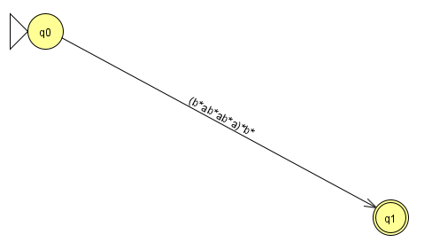

*РВ в НКА, шаг 1*

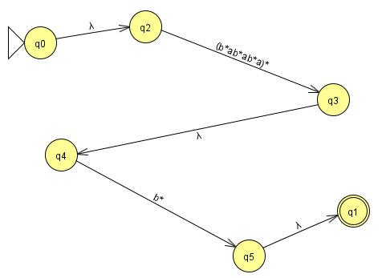

*РВ в НКА, шаг 2*

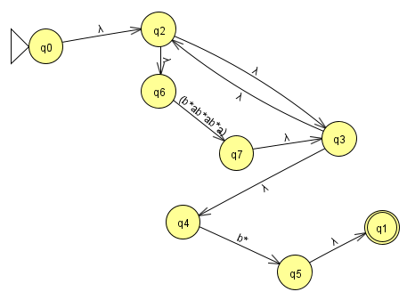

*РВ в НКА, шаг 3*

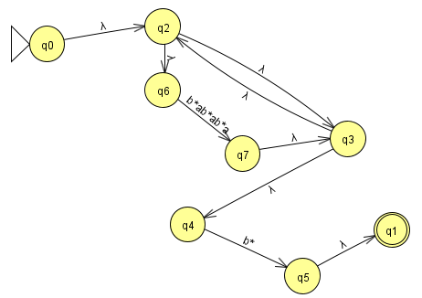

*РВ в НКА, шаг 4*

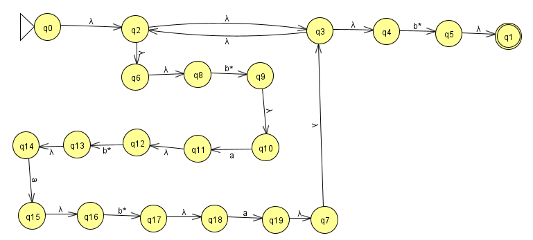

*РВ в НКА, шаг 5*

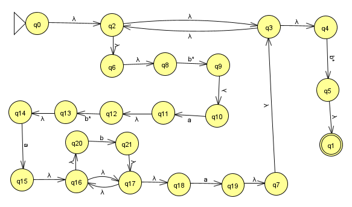

*РВ в НКА, шг 6*

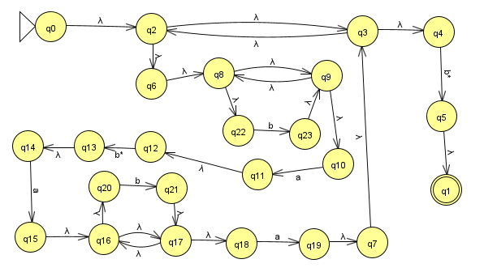

*РВ в НКА, шаг 7*

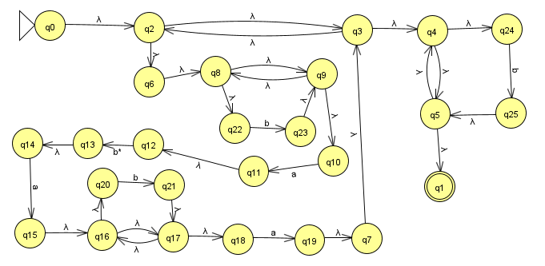

*РВ в НКА, шаг 8*

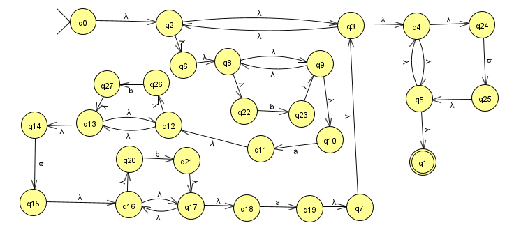

*РВ в НКА, шаг 9*

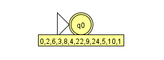

*НКА В ДКА, шаг 1*

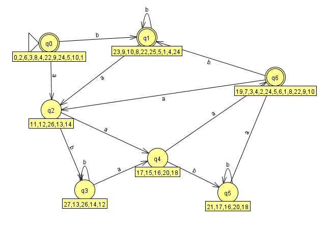

*НКА В ДКА, шаг 2*

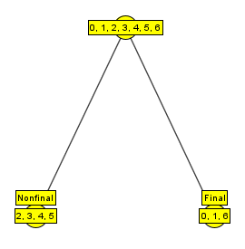

*Минимизация ДКА*

### Полученная РГ и эквивалентное ей РВ

Регулярная грамматика:

    S -> bS | aA | ε
    A -> bA | aB
    B -> bB | aS

(файл RegGr.jff)

Эквивалентное ей РВ:

    (b+ab*ab*a)*

(b+ab\*ab\*a)* эквивалентно (b\*ab\*ab\*a)\*b\*

### Перехваты экранов при пошаговом выполнении процесса преобразования РГ в КА, а также в РВ
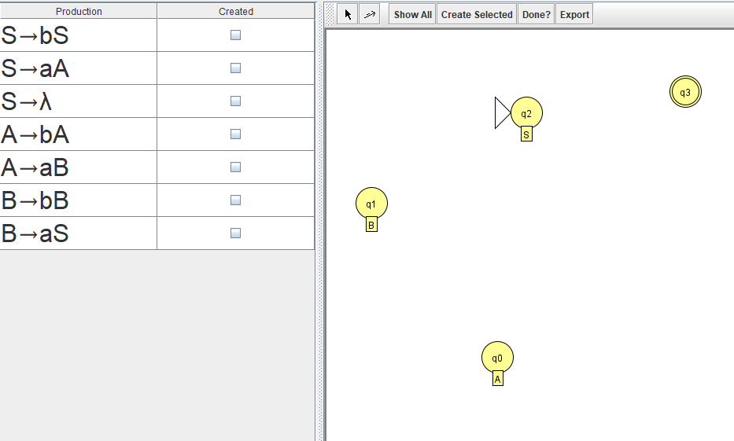

*РГ в КА, шаг 1*

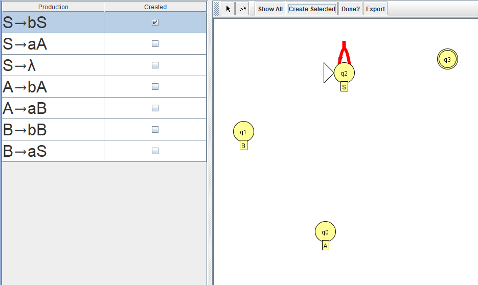

*РГ в КА, шаг 2*

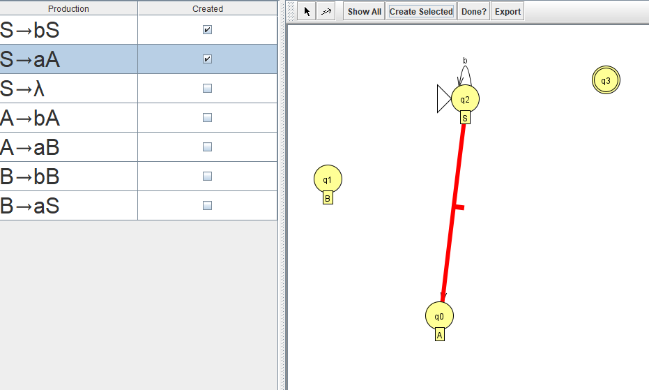

*РГ в КА, шаг 3*

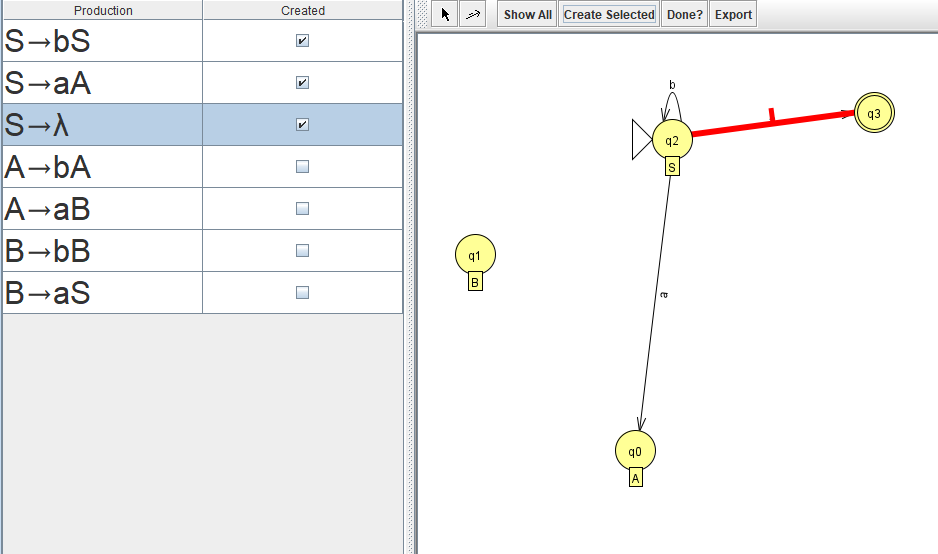

*РГ в КА, шаг 4*

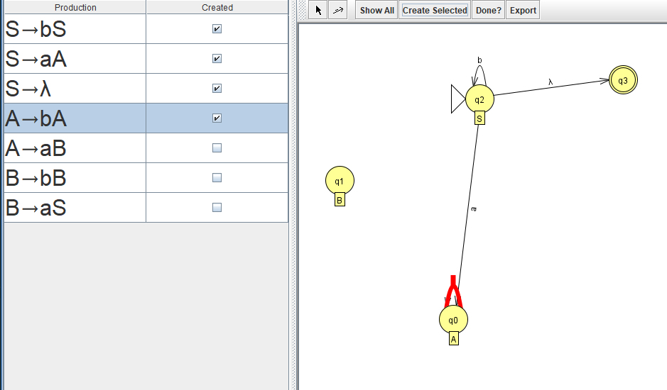

*РГ в КА, шаг 5*

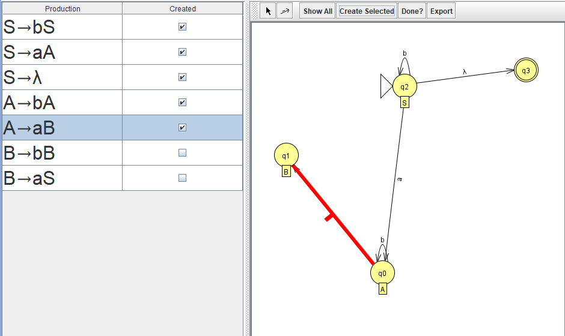

*РГ в КА, шаг 6*

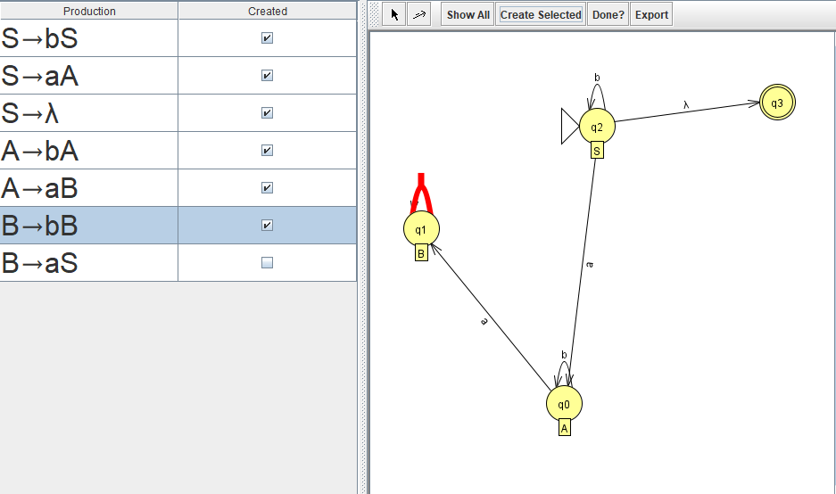

*РГ в КА, шаг 7*

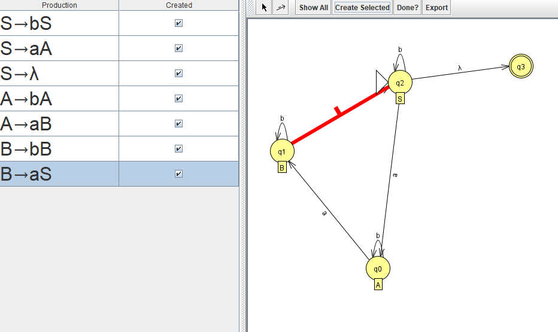

*РГ в КА, шаг 8*

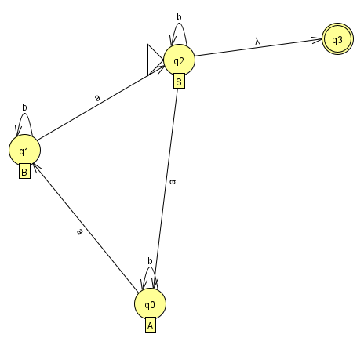

*КА в РВ, шаг 1*

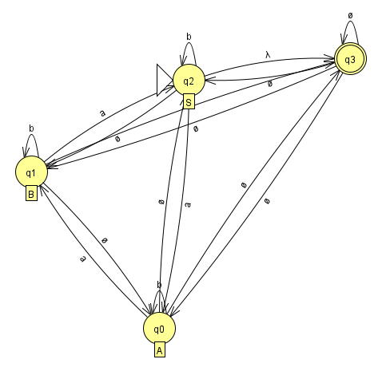

*КА в РВ, шаг 2*

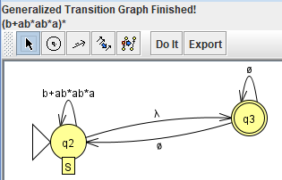

*КА в РВ, шаг 3*

### Формальное доказательство непринадлежности заданного языка к классу РЯ

Язык: L = { w w w w^R | w ∈ {a,b}* }, где w^R - строка, обратная w.

Утверждение: L не является регулярным языком.

Доказательство:

Предположим противное: пусть L регулярен. Тогда по лемме о разрастании
существует такое p >= 1, что любую строку s ∈ L длины |s| >= p можно
представить в виде

    s = x y z

где

    |x y| <= p,   |y| >= 1

и для любого i >= 0 строка x y^i z принадлежит L.

Выберем строку

    u = a^p b

Тогда

    u^R = b a^p

и строка

    s = u u u u^R = (a^p b)(a^p b)(a^p b)(b a^p)

имеет вид

    s = a^p b a^p b a^p b b a^p

Она принадлежит L по определению.

Так как |x y| <= p, а первые p символов строки s - это символы a, то

    y = a^k,   1 <= k <= p

Рассмотрим строку, полученную "выкалыванием" y, то есть положим i = 0:

    s' = x y^0 z = a^{p-k} b a^p b a^p b b a^p

Если бы L был регулярным, то s' ∈ L.

Покажем, что s' ∉ L. В строке s' ровно четыре символа b.
Если s' = v v v v^R для некоторого v ∈ {a,b}*, то в v должен быть
ровно один символ b, так как общее число b равно 4 · |v|_b.
Значит,

    v = a^r b a^s

для некоторых r, s >= 0. Тогда

    v v v v^R = a^r b a^{r+s} b a^{r+s} b a^{2s} b a^r

Сравним это с

    s' = a^{p-k} b a^p b a^p b b a^p

В строке s' между третьим и четвёртым символом b нет ни одного символа a.
Значит, в представлении v v v v^R должно быть

    2s = 0

откуда

    s = 0

Тогда

    v = a^r b

и

    v v v v^R = a^r b a^r b a^r b b a^r

Но в строке s' первый блок символов a равен p - k, а второй блок равен p.
В то же время при v = a^r b первый и второй блоки должны быть одинаковыми
и равными r. Получаем

    p - k = p

что невозможно, так как k >= 1.

Противоречие. Следовательно, s' ∉ L, а значит, предположение о
регулярности L неверно.

L не является регулярным языком.